<p align="center">
  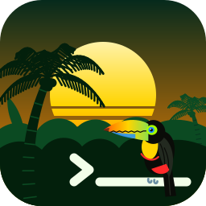
</p>

# Tropical Theme

A family of tropical editor themes for **Zed** and **VS Code**, each one named after a tropical place and colored
from the plants and animals that live there. One generator builds both editors' themes from a single palette table,
so every theme looks the same in both.

| Theme | | Look |
|---|---|---|
| High Contrast | dark | Black, with lagoon-turquoise borders, blue-tang focus, lime strings and pink keywords. Hand-made. |
| Jungle | dark | Deep green, toucan-yellow status bar, scarlet-macaw keywords, monstera strings. |
| Rainforest | dark | Teal-black, morpho-blue frame, tree-frog green strings, golden-frog functions. |
| Cloud Forest | dark | Misty slate, quetzal-green frame, orchid strings. |
| Pantanal | light | Pale wetland green, water-hyacinth violet, hyacinth-macaw keywords. |
| Cenote | dark | Deep teal, turquoise accents, sunbeam keywords, limestone strings. |
| Mangroves | dark | Tannin brown, sunset-orange keywords, spoonbill-pink strings. |
| Beach | light | Sand, sun-yellow status bar, umbrella-red keywords, turquoise strings. |
| Coral Reef | dark | Ocean blue, coral keywords, yellow-tang strings. |
| Bioluminescent Bay | dark | Near-black, plankton-cyan glow, and the only theme with no bold. |
| Volcano | dark | Black, lava red and sulfur yellow. |
| Coffee Highlands | dark | Espresso with a roasted-bean frame and latte accents. Crema keywords, and code colored from coffee cupping notes. |

Each editor has its own folder with what ships to it, and its own README for people installing the themes:

- **[VS Code](vscode/README.md)**: the extension, packed into a `.vsix`.
- **[Zed](zed/README.md)**: a theme extension.

## Install

**VS Code, from a release (easiest, no Ruby needed):**

1. Download `tropical-theme-1.0.0.vsix` from the [latest release](https://github.com/BabsLabs/tropical_theme/releases/latest).
2. Install it from a terminal in the folder you downloaded it to:

   ```bash
   code --install-extension tropical-theme-1.0.0.vsix
   ```

   Or in VS Code, open the Extensions view, click the **...** menu, choose **Install from VSIX...** and pick the file.
3. Run **Developer: Reload Window** and pick one under **Preferences: Color Theme**.

**VS Code, from source:** clone the repo and build the `.vsix` yourself (needs the `code` command and Ruby 3.2+):

```bash
git clone https://github.com/BabsLabs/tropical_theme.git
cd tropical_theme
ruby gen_tropical.rb
code --install-extension tropical-theme-1.0.0.vsix
```

Then run **Developer: Reload Window** and pick one under **Preferences: Color Theme**.

**Zed:** clone the repo as above, open the command palette, run **zed: install dev extension**, and choose the `zed/`
folder. Then pick a theme with **theme selector: toggle**. Zed compiles extensions, so it needs Rust installed through
`rustup`.

## Gallery

| Theme | Screenshot (VS Code) |
|---|---|
| High Contrast | 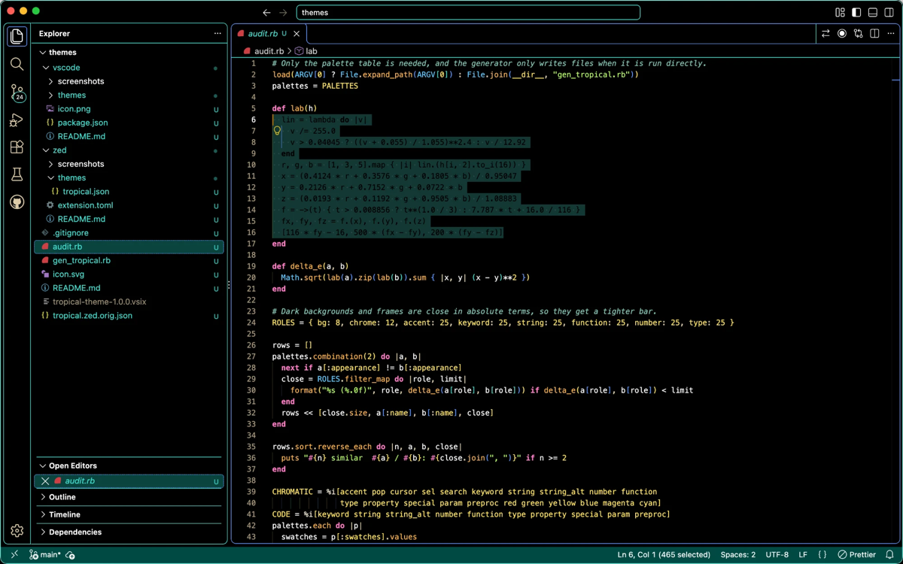 |
| Jungle | 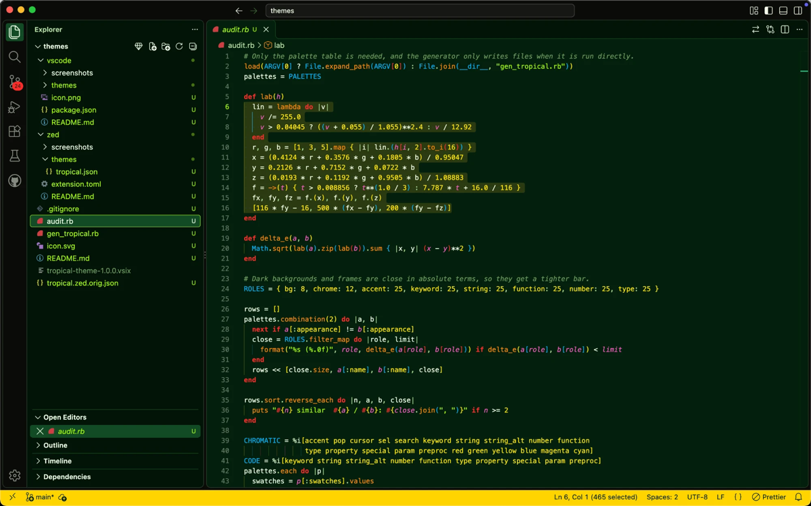 |
| Rainforest | 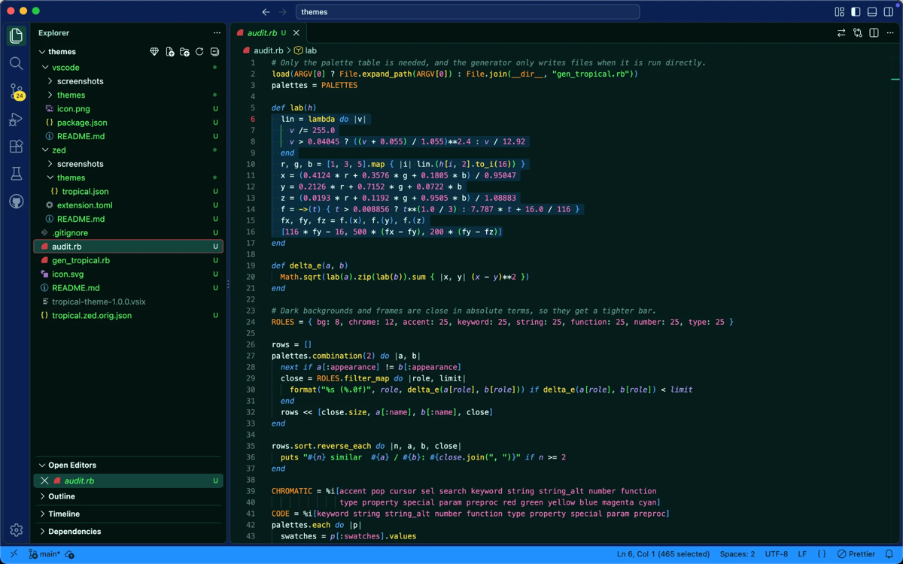 |
| Cloud Forest | 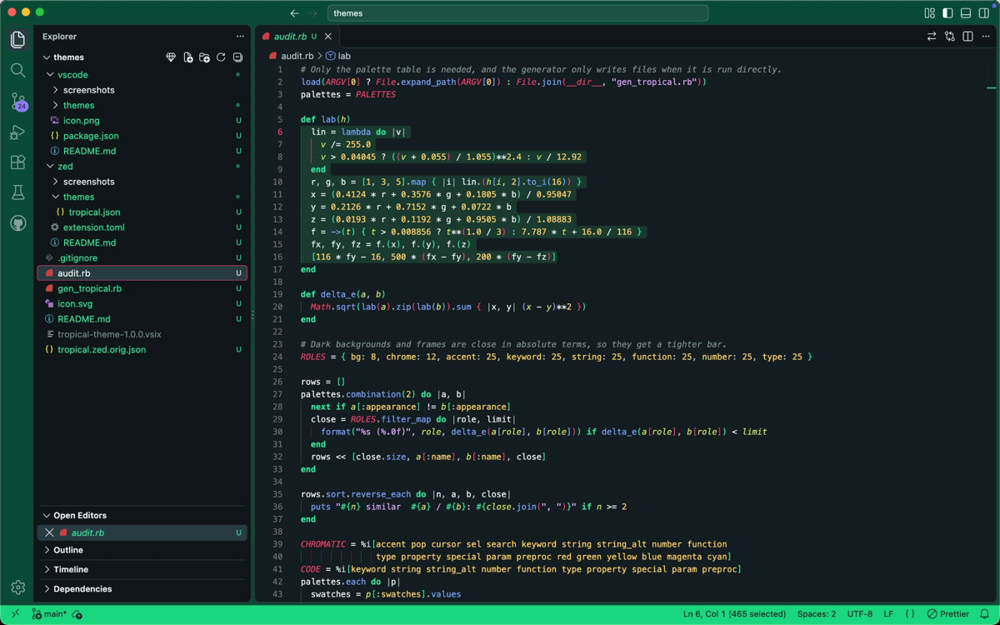 |
| Pantanal | 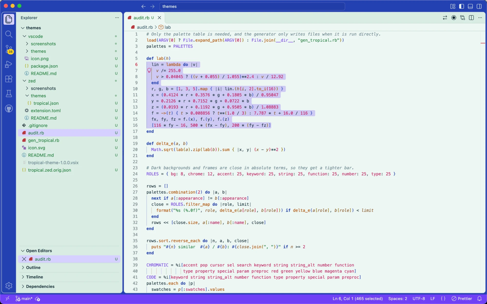 |
| Cenote | 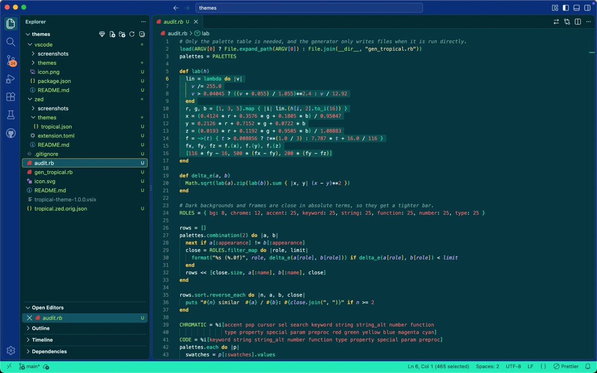 |
| Mangroves | 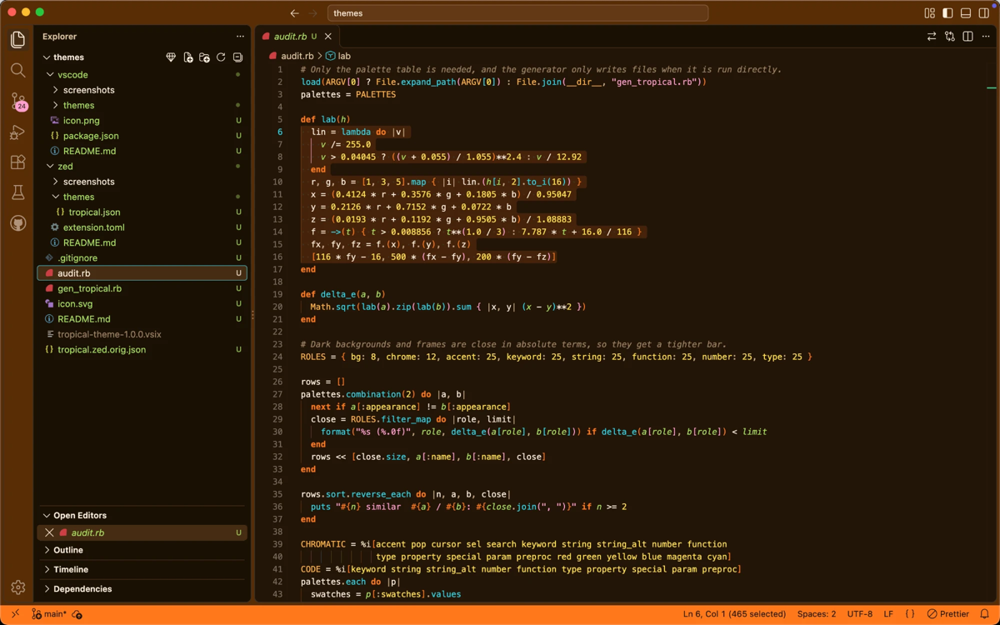 |
| Beach | 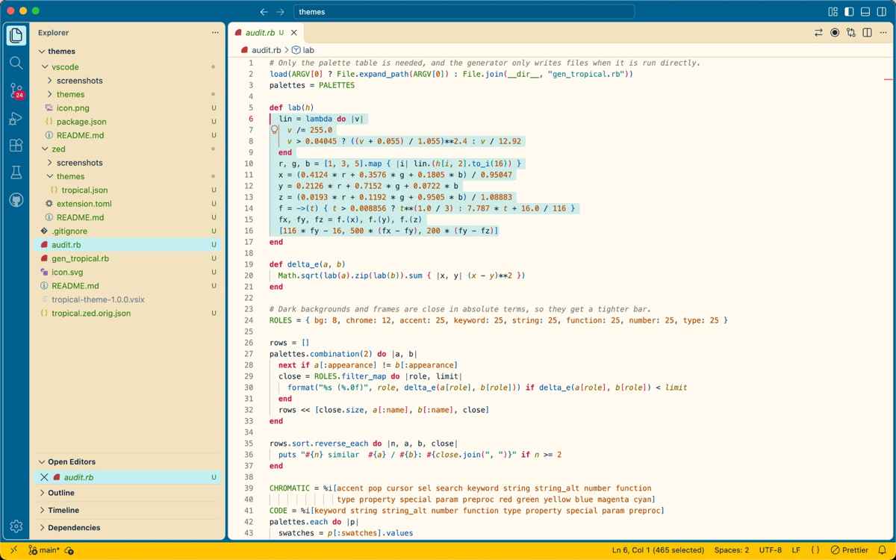 |
| Coral Reef | 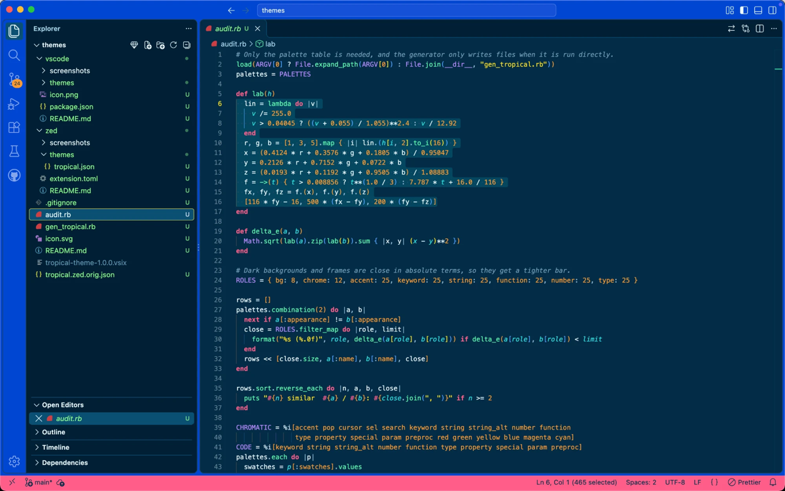 |
| Bioluminescent Bay | 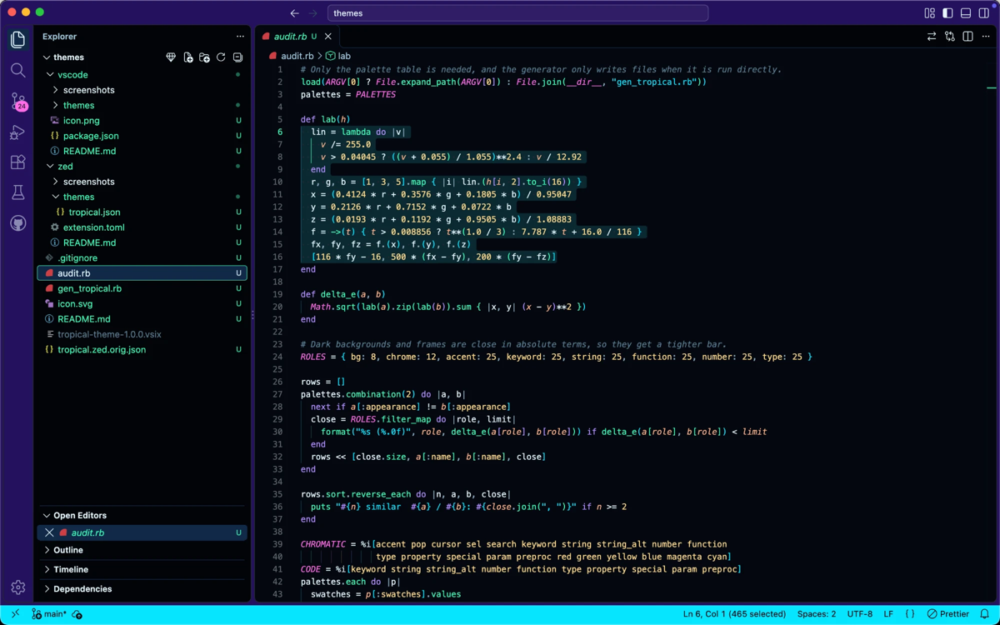 |
| Volcano | 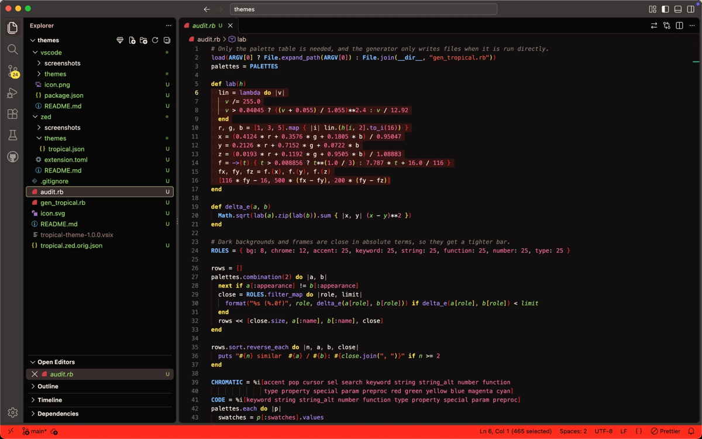 |
| Coffee Highlands | 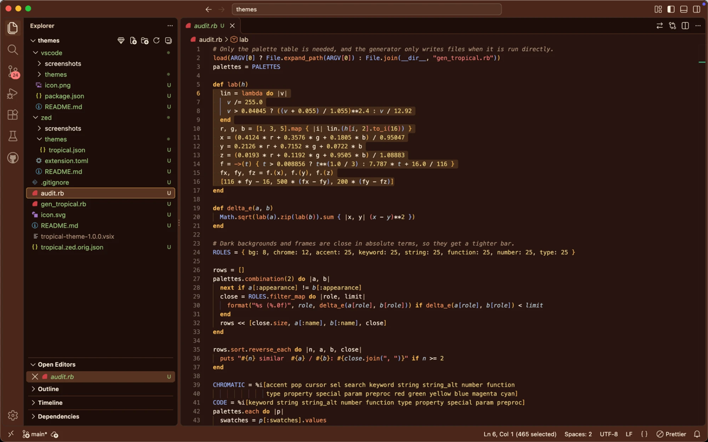 |

## Layout

The shared source and tooling sit at the top level. Each editor folder holds only what ships to that editor.

```
gen_tropical.rb            generator: the palette table plus the Zed and VS Code builders
audit.rb                   checks that the themes, and the colors within each theme, stay distinct
tropical.zed.orig.json     Tropical High Contrast for Zed (hand-made, not generated)
LICENSE                    MIT license; copies sit in vscode/ and zed/ so each extension ships with it
icon.svg                   source for the VS Code extension icon
vscode/                    the VS Code extension
  package.json             manifest; the generator rewrites its version and theme list
  README.md                the page VS Code shows on the extension's details page
  icon.png                 extension icon, exported from icon.svg
  screenshots/             one screenshot per theme, packed into the .vsix
  themes/                  one color theme per palette; all but High Contrast are generated
zed/                       the Zed extension
  extension.toml           manifest; the generator rewrites its version
  README.md                installing and using the themes in Zed
  screenshots/             one screenshot per theme
  themes/tropical.json     every theme in one family file; generated
```

## Requirements

Only Ruby 3.2 or later, using the standard library, to build the themes. The `code` command-line tool is only needed to install the result into VS Code, and Zed needs Rust installed through `rustup` to compile the extension. Installing from a release needs neither Ruby nor the repo.

## Building

1. Edit the palette table in `gen_tropical.rb`.
2. Bump `VERSION` near the top. VS Code caches an extension per version, so a rebuild under the same version keeps showing the old colors. The `.vsix` filename in the Install section above includes the version, so update it there too.
3. Run the generator, then the audit, from this folder:

```bash
ruby gen_tropical.rb
```

```bash
ruby audit.rb
```

The generator prints a contrast report for each theme, then:

- writes `zed/themes/tropical.json` (High Contrast from `tropical.zed.orig.json`, followed by the generated themes) and
  sets the version in `zed/extension.toml`;
- regenerates `vscode/package.json` and `vscode/themes/*.json`, and removes theme files that no longer have a palette;
- builds `tropical-theme-<VERSION>.vsix` in this folder from `vscode/`, including its README, icon and
  screenshots. `.vsix` files are git-ignored.

## Trying a build

**VS Code:** install the build, then run **Developer: Reload Window**:

```bash
code --install-extension tropical-theme-1.0.0.vsix
```

Don't edit the installed copy under `~/.vscode/extensions/`. VS Code keeps showing its cached manifest, so changes made
there don't take effect. Always rebuild under a new version instead.

**Zed:** install the `zed/` folder once with **zed: install dev extension**. After each regeneration, run
**zed: rebuild dev extension** to load the new colors.

Don't also keep a copy of `tropical.json` in `~/.config/zed/themes/`. Zed loads both, and every theme shows up twice.

## Screenshots

`vscode/screenshots/` and `zed/screenshots/` hold one PNG per theme. Each file is named after the theme's slug, the
same one its VS Code theme file uses: `high-contrast.png`, `jungle.png`, `rainforest.png`, `cloud-forest.png`,
`pantanal.png`, `cenote.png`, `mangroves.png`, `beach.png`, `coral-reef.png`, `bioluminescent-bay.png`, `volcano.png`
and `coffee-highlands.png`. This README and both editor READMEs show them.

- Take them from a throwaway sample project, never from real app code.
- Use the same sample file and window size in both editors, so the gallery compares like with like.
- Every PNG under `vscode/` goes into the `.vsix`, so keep the files small. The current ones are 1200px wide; shown at 400px in the gallery, that is plenty.

## How a palette works

Each entry in `PALETTES` is one theme:

- `swatches` names the theme's colors after real things in that place (`toucan_beak`, `crema`, `lava`). Every colored
  role refers to a swatch by name, so each color is defined once. Surfaces and text (`bg`, `panel`, `fg`, `muted`, …)
  stay literal hex values.
- Interface roles:
  - `chrome` colors the title bar and activity bar.
  - `accent` colors VS Code's status bar and buttons.
  - `pop` colors badges and debug items.
  - `cursor` and `sel` set the cursor and selection colors.
- Code roles are `keyword`, `string`, `string_alt` (regex and symbols), `number`, `function`, `type`, `property`,
  `special` (`self`, `@ivars`), `param` and `preproc`.
- `icons` lists the six signature colors used for bracket pairs, indent guides, Zed accents and collaborators. The
  sixth also colors Zed's AI agent, so it must never be a green or red that would read as a diff.
- Terminal colors are `black`, `red`, `green`, `yellow`, `blue`, `magenta`, `cyan` and `white`. Errors, warnings, info
  and git colors are derived from them.
- Optional keys:
  - `keyword_style` and `type_style` set bold or italic.
  - `param_style` defaults to italic.
  - `status` names another role for VS Code's status bar; Coffee Highlands uses `status: "chrome"`.

The generator warns when any of these fall under the given contrast:

- text, code and bracket colors under 4.5:1 against the background;
- comments, line numbers, placeholders and the cursor under 3:1;
- text on the title bar, status bar, buttons and badges under 4.5:1.

`audit.rb` compares themes with the same appearance, light or dark. It flags:

- two themes that are close on two or more of background, chrome, accent, keyword, string, function, number and type;
- any colored role that isn't one of the theme's swatches;
- two code colors in one theme that are near-twins (CIELAB ΔE under 20);
- two dark themes whose background, chrome and accent together are too similar to tell apart at thumbnail size.

## Tropical High Contrast

High Contrast is hand-made and not in the palette table:

- **Zed:** `tropical.zed.orig.json`. The generator splices the generated themes in after it, so its formatting is kept.
- **VS Code:** `vscode/themes/tropical-high-contrast-color-theme.json`. It's the first theme entry in `package.json`,
  and the generator leaves that entry alone.

Both files use the same set of hex values, so change a color in both. Every syntax color is at least 7:1 against
black.

Keep `tropical.zed.orig.json` at the top level. Never put it in `zed/themes/` or `~/.config/zed/themes/`: Zed loads
every JSON file in a themes folder, and you would get High Contrast twice.

## Zed quirks

- Zed draws title and status bar text in its single global text color. The bars therefore use `chrome` only when that
  text is readable on it (4.5:1). Otherwise they use `panel`, which is what happens for the light themes' dark chrome.
- Zed's `colorize_brackets` and `indent_guides.coloring` settings take their colors from each theme's `icons` (its
  `accents`).

## The icon

`icon.svg` shows a keel-billed toucan perched on a `>_` terminal prompt at jungle dusk, with a striped retro sun,
two coconut palms and the canopy behind it. VS Code shows it in the Extensions view; neither editor shows icons in its theme
picker. After editing the SVG, export it with macOS's built-in `sips`:

```bash
sips -s format png icon.svg --out vscode/icon.png
```

## Sharing

- **VS Code:** point people at the [latest release](https://github.com/BabsLabs/tropical_theme/releases/latest) and its `.vsix`, or send the file directly. They install it with `code --install-extension`. One install adds every theme.
- **Zed:** send the `zed/` folder and install it with **zed: install dev extension**, or copy `zed/themes/tropical.json`
  into the other person's `~/.config/zed/themes/`. Either one adds every theme. Publishing to Zed's extension registry
  needs a `repository` URL in `zed/extension.toml` and a license file in `zed/`; both are already there.

## License

[MIT](LICENSE)
