# Tropical Theme

Twelve tropical color themes for Zed, each named after a tropical place and colored from the plants and animals
that live there.

## Installing

Install this folder as an extension. Open the Command Palette, run **zed: install dev extension**, and choose this
`zed` folder. When the themes change, run **zed: rebuild dev extension** to load the new colors.

If you'd rather not install an extension, copy `themes/tropical.json` into `~/.config/zed/themes/`. Zed picks it up
without a restart.

Use only one of these. With both, Zed lists every theme twice.

## Choosing a theme

Open the theme selector (<kbd>Cmd</kbd>+<kbd>K</kbd> <kbd>Cmd</kbd>+<kbd>T</kbd>, or **theme selector: toggle** in the
Command Palette) and type `Tropical` to preview the themes.

To switch between a light and a dark theme with your system's appearance, set `theme` in your settings:

```json
"theme": {
  "mode": "system",
  "light": "Tropical Beach",
  "dark": "Tropical Jungle"
}
```

## Recommended settings

Every theme has six signature colors. Zed uses them for colored bracket pairs and indent guides once you turn those
on:

```json
"colorize_brackets": true,
"indent_guides": {
  "coloring": "indent_aware"
}
```

## Themes

### Tropical High Contrast

Dark. Black, with lagoon-turquoise borders, lime strings and pink keywords.

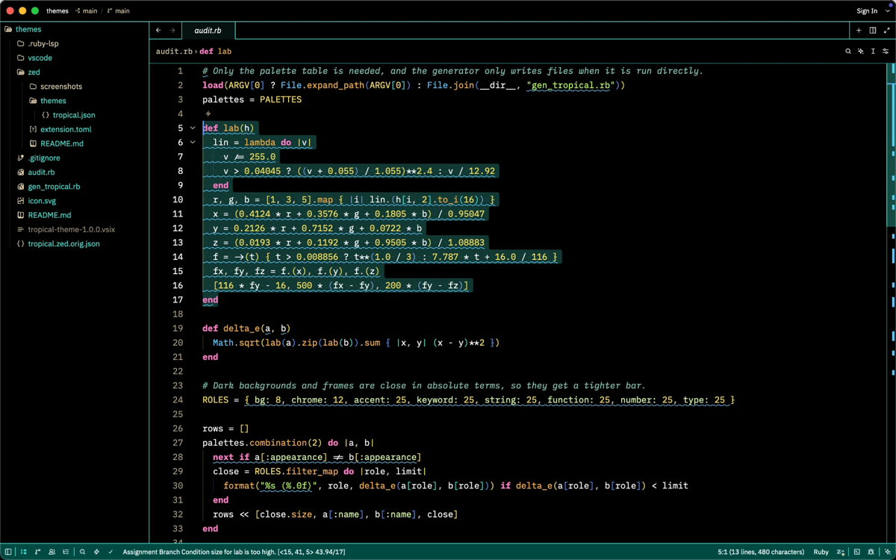

### Tropical Jungle

Dark. Deep green, scarlet-macaw keywords and monstera strings.

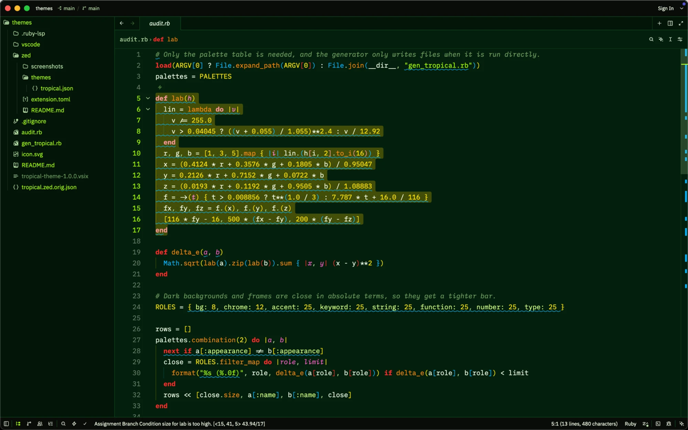

### Tropical Rainforest

Dark. Teal-black, a morpho-blue frame, tree-frog green strings and golden-frog functions.

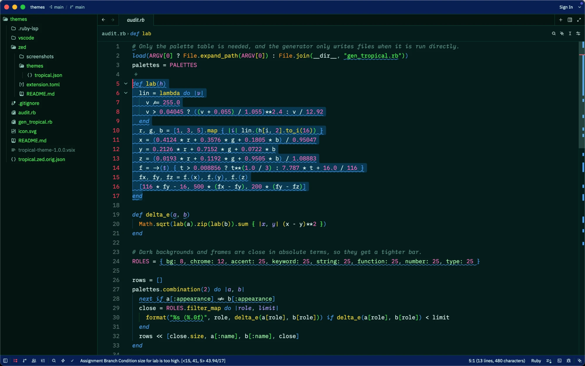

### Tropical Cloud Forest

Dark. Misty slate, a quetzal-green frame and orchid strings.

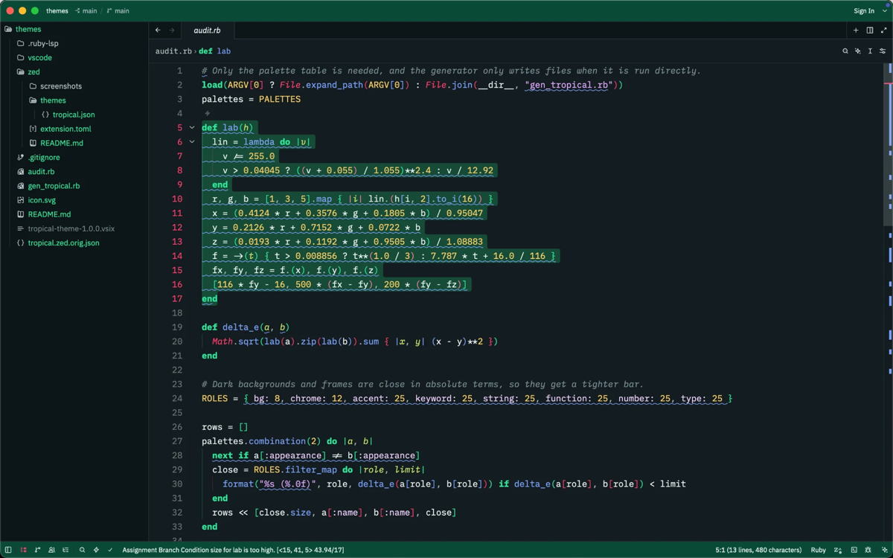

### Tropical Pantanal

Light. Pale wetland green, water-hyacinth violet and hyacinth-macaw keywords.

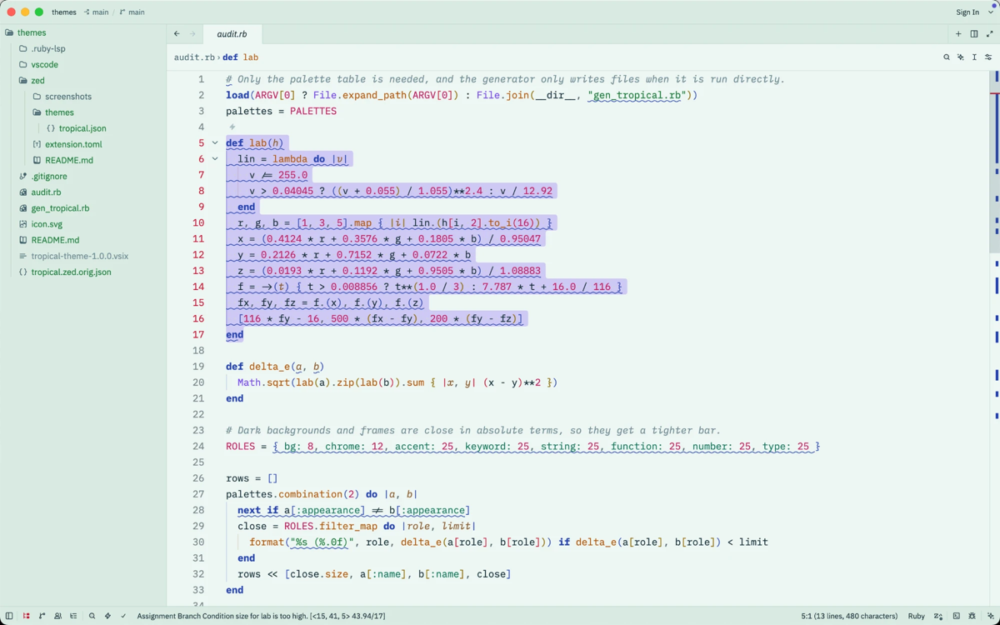

### Tropical Cenote

Dark. Deep teal, turquoise accents, sunbeam keywords and limestone strings.

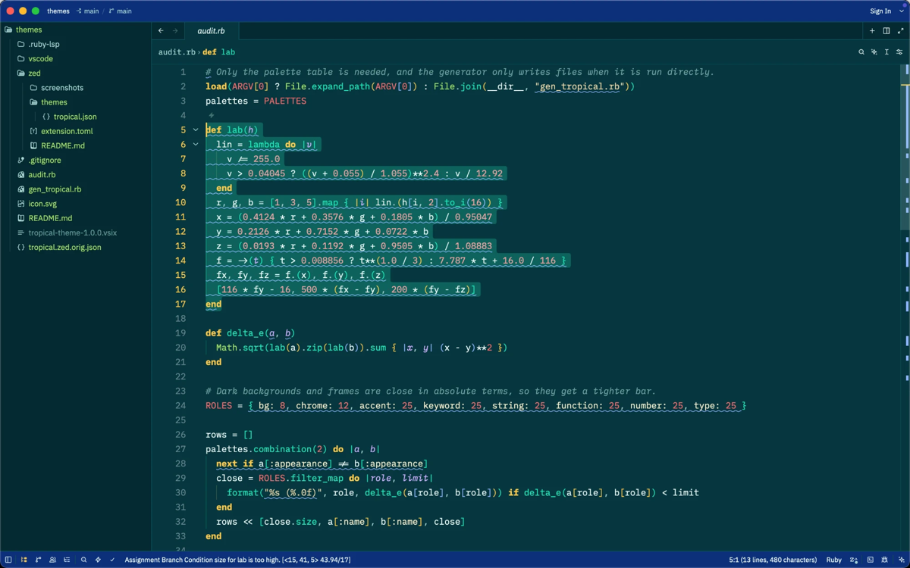

### Tropical Mangroves

Dark. Tannin brown, sunset-orange keywords and spoonbill-pink strings.

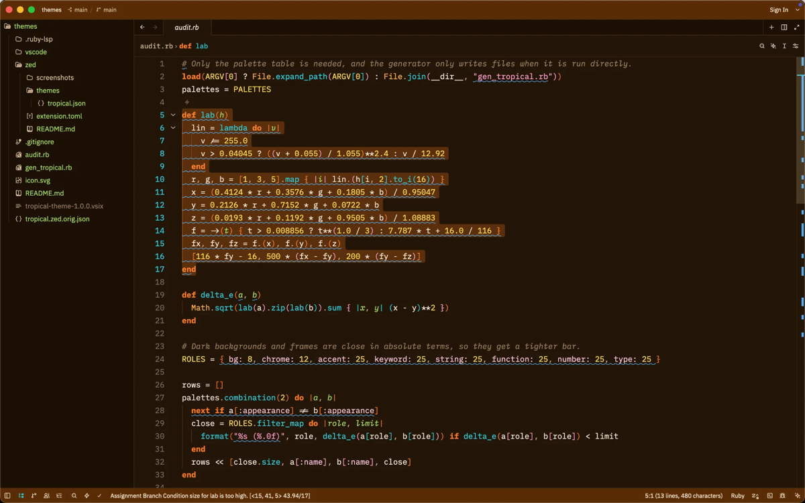

### Tropical Beach

Light. Sand, umbrella-red keywords and turquoise strings.

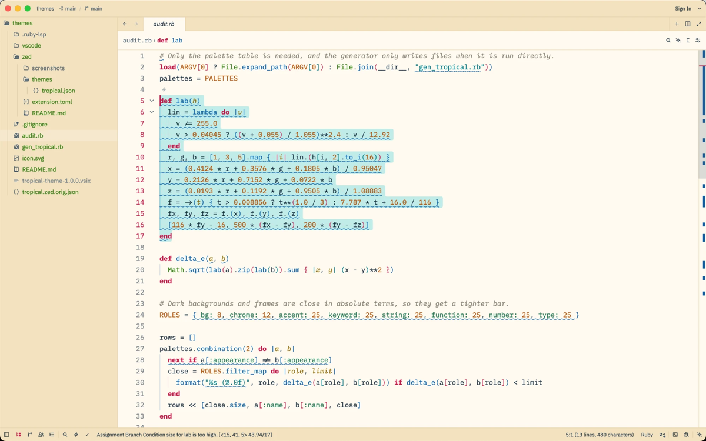

### Tropical Coral Reef

Dark. Ocean blue, coral keywords and yellow-tang strings.

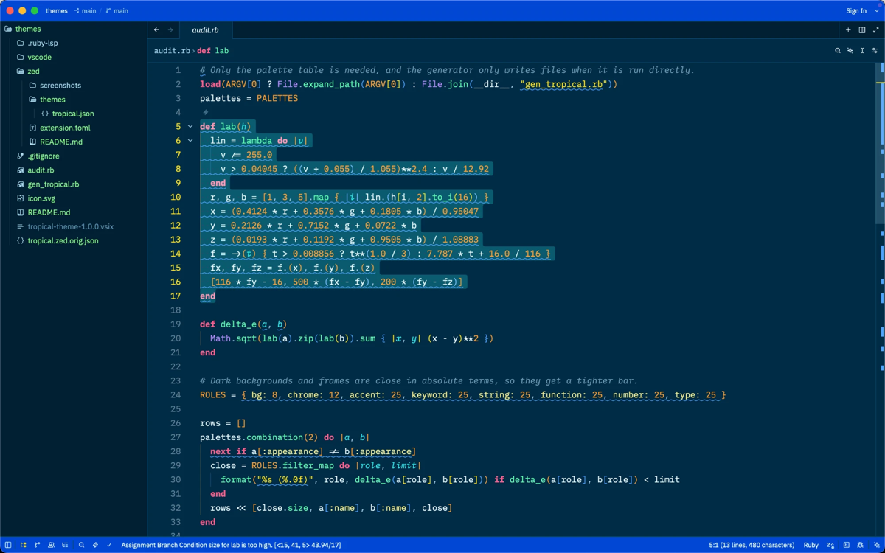

### Tropical Bioluminescent Bay

Dark. Near-black with a plankton-cyan glow.

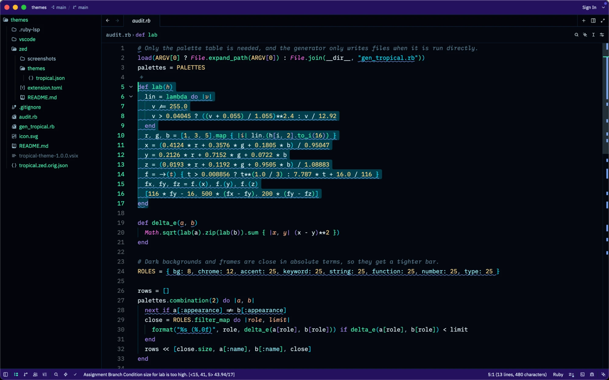

### Tropical Volcano

Dark. Black, lava red and sulfur yellow.

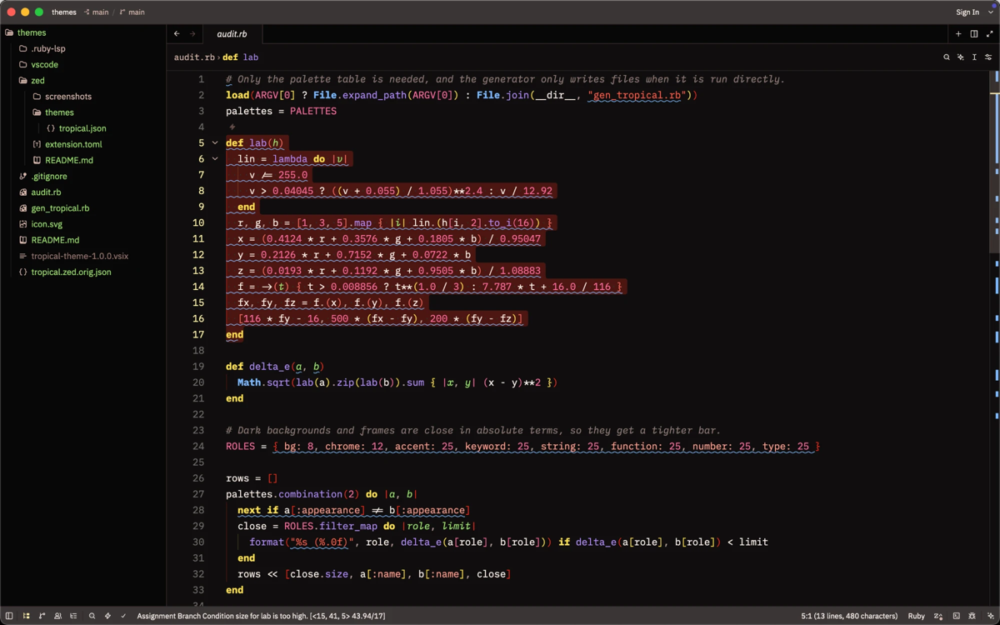

### Tropical Coffee Highlands

Dark. Espresso and latte, with crema keywords and code colored from coffee tasting notes.

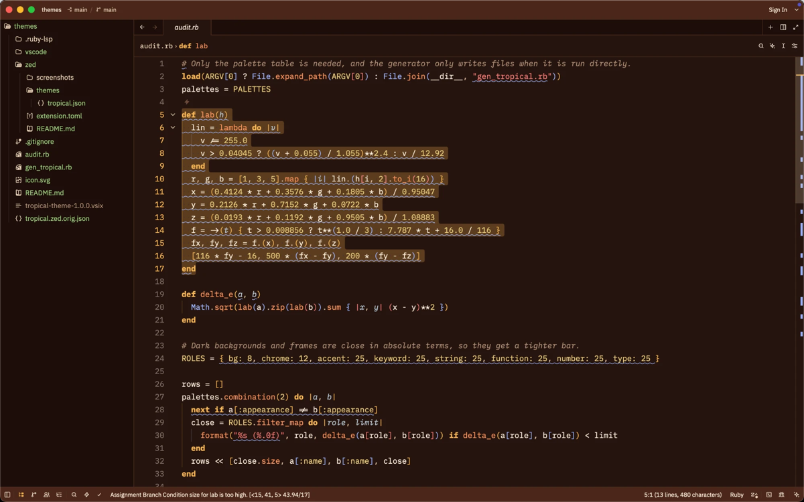
